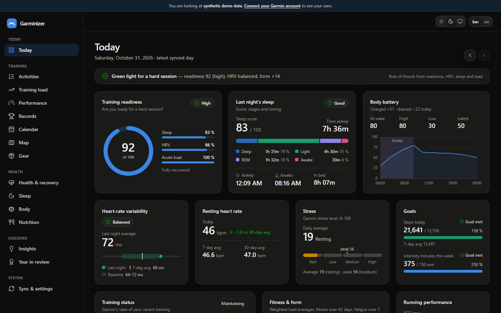
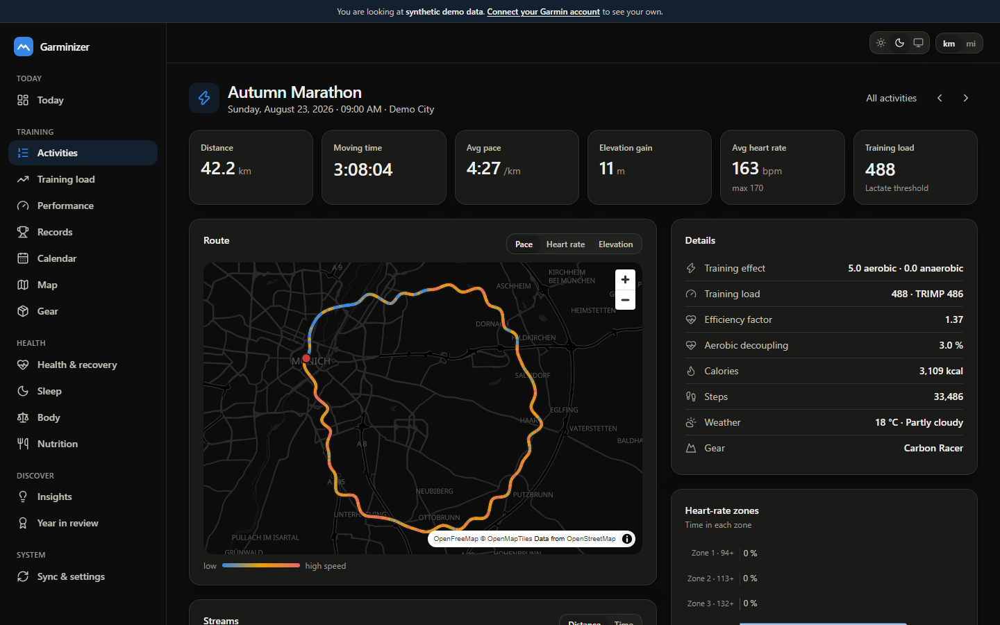
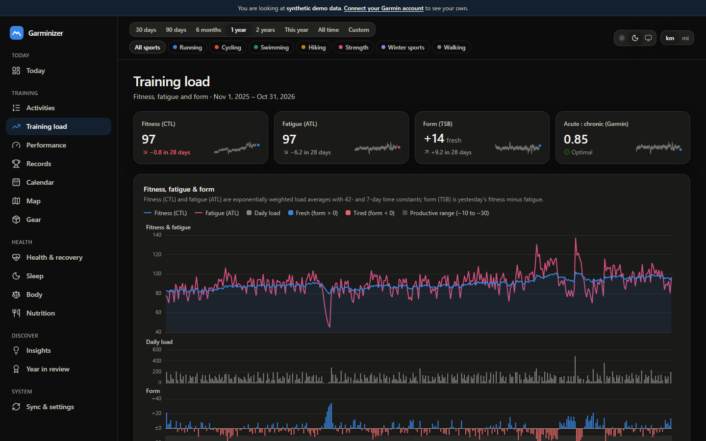
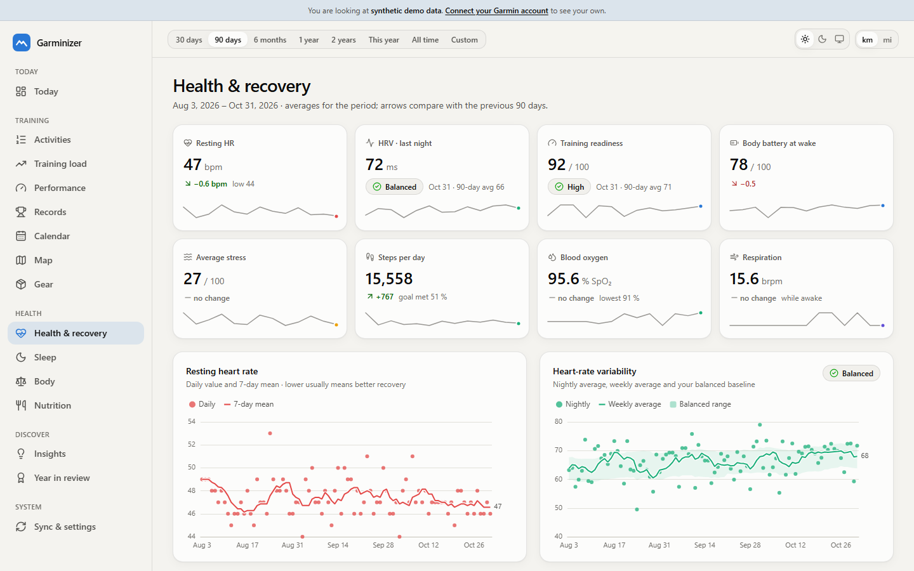
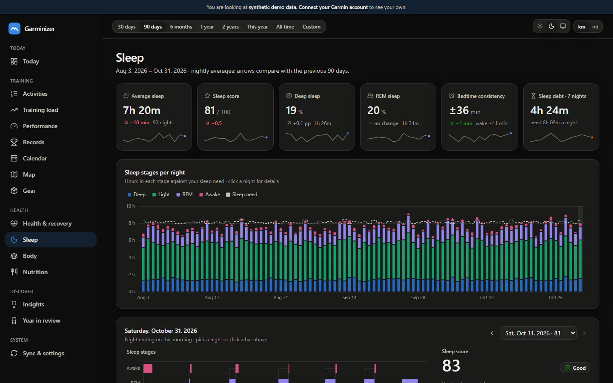
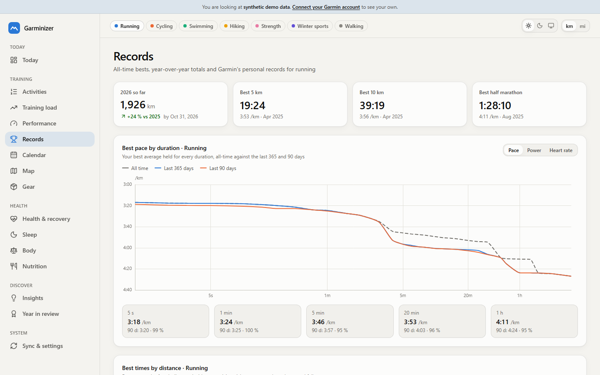
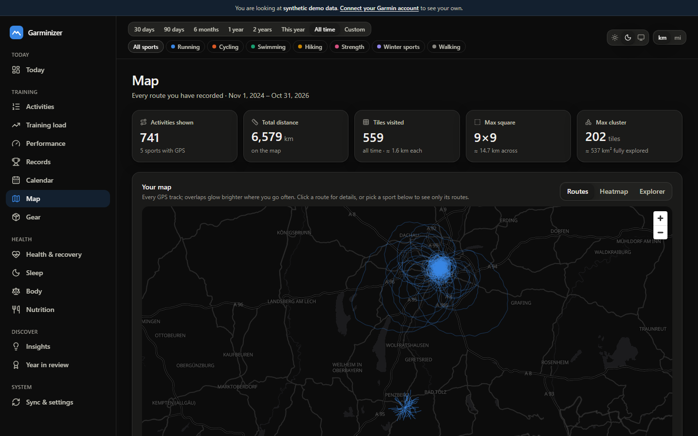
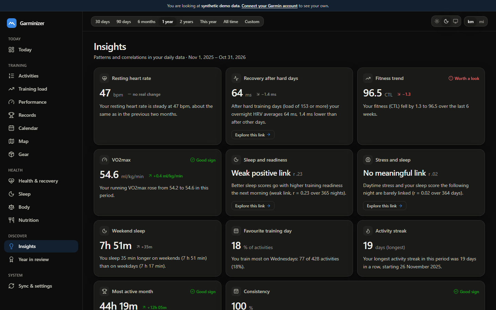
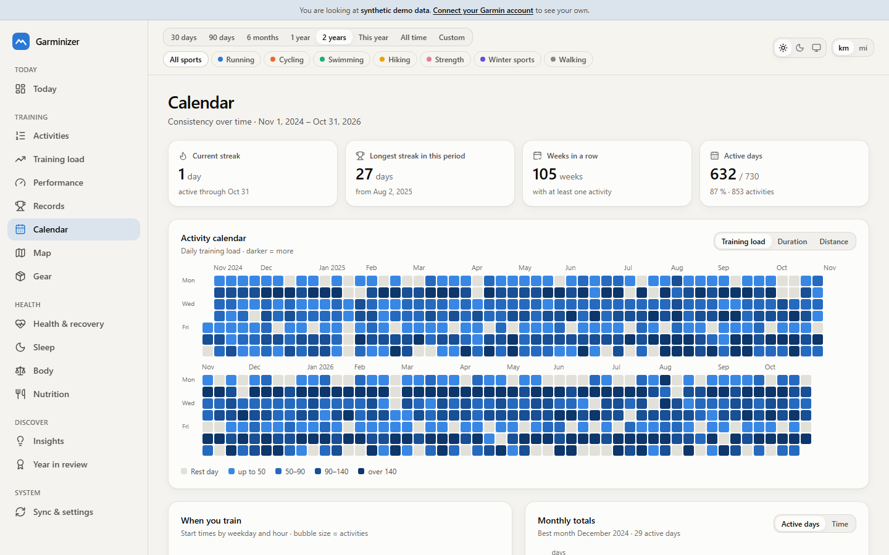

<div align="center">

# Garminizer

**Your Garmin data, in your own database, beautifully visualized.**

Garminizer pulls *everything* from your Garmin Connect account — activities with every
second of GPS, heart rate, pace and power, plus sleep, HRV, stress, Body Battery, readiness,
VO2max, weight and more — stores it in a well-documented PostgreSQL database on your own
computer, and turns it into fast, interactive dashboards.

[](https://github.com/wintermute422/garminizer/actions/workflows/ci.yml)
[](LICENSE)



</div>

> Screenshots show the built-in **synthetic demo athlete**, not a real person.

## Contents
- [What you get](#what-you-get) · [Screenshots](#screenshots) · [Quick start](#quick-start) ·
  [Try the demo](#try-the-demo-no-garmin-account-needed) · [How it works](#how-it-works) ·
  [Meal logging](#log-meals-with-claude-desktop) ·
  [Your data, your database](#your-data-your-database) · [Privacy](#privacy--security) ·
  [Documentation](#documentation) · [Development](#development) · [FAQ](docs/faq.md)

## What you get
| Dashboard | Highlights |
|---|---|
| **Overview** | readiness, last night's sleep, HRV vs baseline, resting HR, Body Battery today, steps & intensity minutes, training status and load focus, fitness/fatigue/form, VO2max, race predictions, this week vs last week |
| **Activities** | searchable, sortable list with totals per sport |
| **Activity detail** | route coloured by pace/HR/elevation, linked elevation/HR/pace/cadence/power charts with a map cursor, HR zones, km/mile splits, laps, best-effort curve vs your all-time bests, weather, gear, efficiency & aerobic decoupling |
| **Training load** | fitness (CTL), fatigue (ATL) and form (TSB), ACWR with the optimal band, Garmin training status, 28-day load focus, weekly/monthly volume by sport, time in HR zones, training-effect map |
| **Performance** | VO2max, race-time predictions, endurance & hill score, fitness age, efficiency trends |
| **Records** | mean-maximal speed/power/HR curves (all time vs last year vs 90 days), best times for 400 m … marathon with progression, year-over-year cumulative distance, top activities, Garmin PRs |
| **Health & recovery** | resting HR, HRV with baseline band, readiness, stress composition, Body Battery ranges, SpO2, respiration, steps, hour × day heatmaps with drill-down into any day |
| **Sleep** | stages per night, sleep score, bed/wake-time consistency, weekday vs weekend, hypnogram with overnight HR/SpO2/respiration, sleep debt |
| **Body** | weight with trend line, body fat, muscle mass, blood pressure |
| **Nutrition** | meals logged through Claude Desktop: eaten vs Garmin's burn per day, energy balance, macros, protein per kg, targets, week-by-week balance next to weight |
| **Calendar** | multi-year activity heatmap, streaks, weekday × hour punchcard |
| **Map** | every route you ever recorded, a heatmap, and explorer tiles with your max square |
| **Insights** | auto-generated findings, correlation matrix between daily metrics (with lag), scatter explorer, weekday patterns |
| **Gear** | mileage and wear of shoes and bikes |
| **Year in review** | your year in numbers, highlights and best efforts |
| **Sync & settings** | connect Garmin (with 2-factor), sync status and history coverage |

Dark and light themes, metric and imperial units, works on phones, every view shareable by URL.

## Screenshots
| | |
|---|---|
|  |  |
|  |  |
|  |  |
|  |  |

## Quick start
Requirements: [Docker Desktop](https://www.docker.com/products/docker-desktop/) (Windows, macOS)
or Docker Engine with Compose (Linux).

```bash
git clone https://github.com/wintermute422/garminizer.git
cd garminizer
cp .env.example .env          # then edit .env: set POSTGRES_PASSWORD (and TZ)
docker compose up -d --build
```

Open **http://localhost:8420**, go to **Sync & settings → Connect Garmin**, sign in with your
Garmin account (enter the code if you use two-factor authentication). The worker syncs recent days
first and then works back through your whole history — dashboards fill up as it goes. It keeps
syncing every two hours and makes a nightly backup to `data/backups`.

The stack starts automatically with Docker. Update with `git pull && docker compose up -d --build`.
See [configuration & operations](docs/configuration.md) for phone access on your LAN, backups,
restore and all settings.

## Try the demo (no Garmin account needed)
```bash
docker compose -f compose.demo.yml up -d --build
```
Open **http://localhost:8430** — two years of a simulated athlete (training plan with races,
illness and holidays; sleep, HRV and readiness respond to training load). The demo uses its own
database and never mixes with your real data.

## Log meals with Claude Desktop
Tell [Claude Desktop](https://claude.ai/download) what you ate, or send it a photo of your plate.
Claude estimates portions, calories and macros and hands them to your local Garminizer over the
Model Context Protocol; Garminizer stores the meal and answers with your day so far against
Garmin's calorie burn. One entry in Claude Desktop's config connects them:

```json
{ "mcpServers": { "garminizer": { "command": "docker",
  "args": ["exec", "-i", "garminizer-app-1", "garminizer", "mcp"] } } }
```

Setup, tools, accuracy and privacy: [Claude Desktop guide](docs/claude-desktop.md).

## How it works
```
Garmin Connect ──read-only──▶ worker ──▶ raw JSON ──▶ typed tables ──▶ analytics ──▶ API ──▶ dashboards
                                        (PostgreSQL 17, schema "garmin", on your computer)
```
- **Sync**: the community library [`garminconnect`](https://github.com/cyberjunky/python-garminconnect)
  with a read-only whitelist, a polite request rate and automatic backoff. Every response is kept
  verbatim, so improved parsers can rebuild everything without downloading again.
- **Activities at full resolution** from the original FIT files.
- **Analytics**: training load (CTL/ATL/TSB, ACWR), TRIMP, mean-max curves, best distance times,
  zones, splits, efficiency, decoupling, explorer tiles, correlations — see [metrics](docs/metrics.md).
- **Stack**: FastAPI, SQLAlchemy, Alembic · React 19, TanStack, Apache ECharts, MapLibre GL,
  OpenFreeMap tiles · Docker Compose. Details in [architecture](docs/architecture.md).

## Your data, your database
Everything lands in PostgreSQL with a documented schema — ~45 tables and views, each table and
important column commented ([data model](docs/data-model.md)). Connect any SQL client to
`127.0.0.1:55433` and explore; `garmin.v_daily` gives you one row per day with every daily metric.

```sql
-- weekly running distance and average heart rate
SELECT date_trunc('week', start_time_local) AS week,
       round(sum(distance_m) / 1000) AS km, round(avg(avg_hr)) AS avg_hr
FROM garmin.activity WHERE sport_group = 'run'
GROUP BY 1 ORDER BY 1 DESC LIMIT 12;
```

## Privacy & security
- Runs entirely on your computer; the dashboard is bound to `127.0.0.1` unless you opt in to LAN
  access with a password.
- Your Garmin password is never stored — only Garmin's tokens, in `data/tokens`.
- Read-only access to Garmin. Nothing is sent anywhere except requests to Garmin and map tiles.
  (If you use meal logging, what you ask Claude Desktop, and the tool answers it reads, are part
  of your Claude conversation; see the [guide](docs/claude-desktop.md#privacy).)
- See [SECURITY.md](SECURITY.md).

## Documentation
[Architecture](docs/architecture.md) · [Data model](docs/data-model.md) ·
[Metrics](docs/metrics.md) · [Configuration & operations](docs/configuration.md) ·
[Claude Desktop meal logging](docs/claude-desktop.md) ·
[FAQ](docs/faq.md) · [Development harness](docs/development.md) · [Contributing](CONTRIBUTING.md)

## Development
```bash
git config core.hooksPath .githooks
python -m venv .venv && .venv/bin/pip install -e ".[dev]"
pnpm -C web install
bash scripts/devdb.sh up && .venv/bin/garminizer demo seed
.venv/bin/garminizer serve            # API on :8420
pnpm -C web dev                       # UI on :5180
bash scripts/check.sh                 # the full gate
bash scripts/e2e.sh                   # Playwright on every page, 4 variants
```
See [CONTRIBUTING.md](CONTRIBUTING.md).

## Disclaimer
Garminizer is an independent open-source project. It is not affiliated with, endorsed by or
supported by Garmin Ltd. "Garmin" and "Garmin Connect" are trademarks of Garmin Ltd. The project
uses an unofficial API that may change without notice. Metrics are for information only and are
not medical advice.

## License
[MIT](LICENSE)
